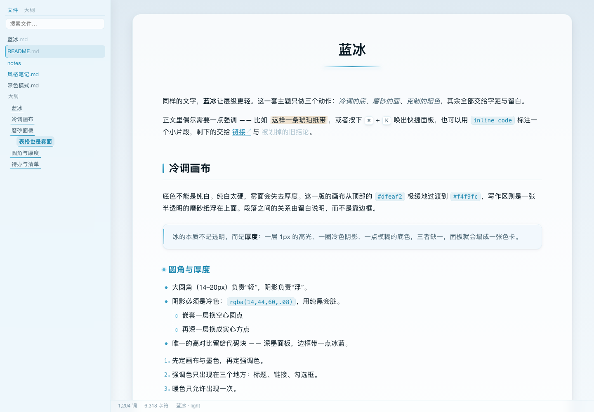
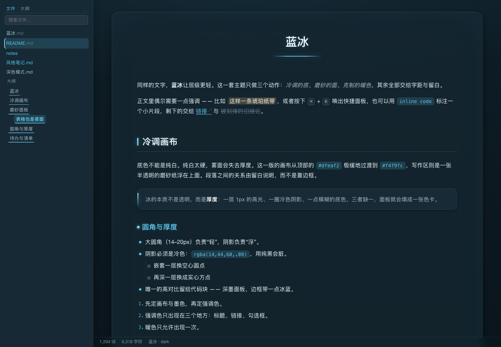
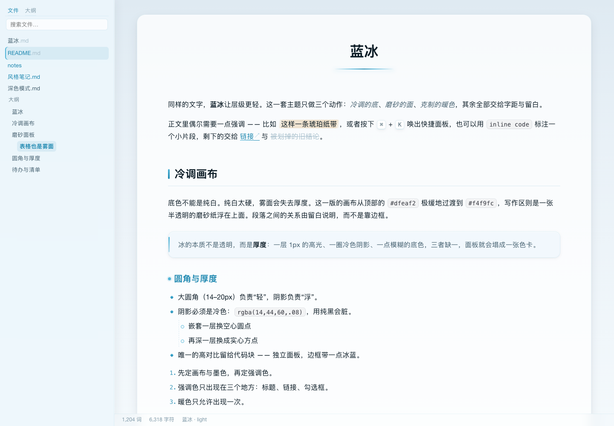
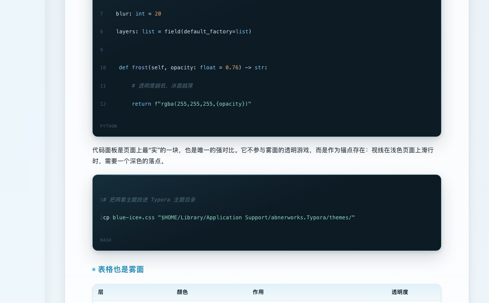
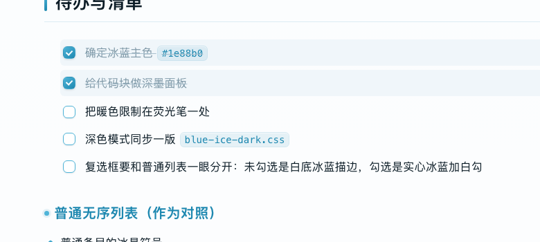
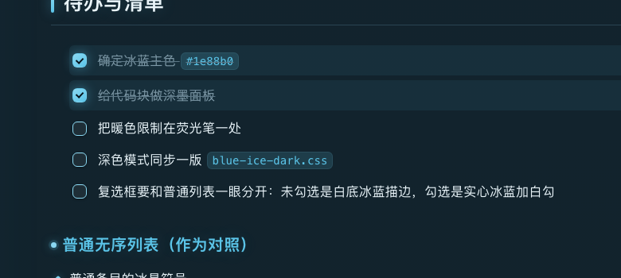

# 蓝冰 · Blue Ice

一套 **Typora 主题**，三个版本：冷蓝的底、雾面的面板、外加一处被严格限制的暖琥珀色。代码区有两种口味 —— 深墨面板，或浅灰纸面（One Light 配色）。

名字取「蓝」给颜色（`#1e88b0` 这支冷蓝，就是蓝冰本身的色），「冰」给质感（雾、结晶、冷冽的反光）。英文名 **Blue Ice** 即中文名的直译，也正是指冰川压实的致密蓝冰 —— 这套配色的出处。

[在线预览](https://jdante313.github.io/typora-blue-ice/) · [下载](../../releases/latest) · [反馈 Issues](../../issues)

| 浅色 `Blue Ice` | 深色 `Blue Ice Dark` |
| --- | --- |
|  |  |

| 浅色 + 浅灰代码 `Blue Ice Paper` |
| --- |
|  |



待办清单：未勾选是白底冰蓝描边、勾选是实心冰蓝加白勾，已完成整行压灰加划线 —— 与普通无序列表的冰晶符号一眼分开。

| 待办 · 浅色 | 待办 · 深色 |
| --- | --- |
|  |  |

---

## 安装

### 方式一：一键脚本（macOS / Linux / Windows Git Bash）

```bash
git clone https://github.com/Jdante313/typora-blue-ice.git
cd typora-blue-ice
bash install.sh
```

脚本只做一件事：把下面三个 CSS 拷进 Typora 主题目录，不会动你已有的其他主题。

### 方式二：手动（推荐，最稳）

1. 下载本仓库（或只下需要的 CSS 文件）。
2. 打开 Typora：**文件 → 偏好设置 → 外观 → 打开主题文件夹**。
3. 把 CSS **直接放进这个目录**（放进子文件夹不会被识别）。
4. 回到 **外观 → 主题**，选择 `Blue Ice`、`Blue Ice Dark` 或 `Blue Ice Paper`。

三个文件互相独立，可以只装其中一个：

| 文件 | 主题列表里的名字 | 内容 |
| --- | --- | --- |
| `blue-ice.css` | `Blue Ice` | 浅色 + 深墨代码块（主推） |
| `blue-ice-dark.css` | `Blue Ice Dark` | 深色 + 深墨代码块 |
| `blue-ice-paper.css` | `Blue Ice Paper` | 浅色 + 浅灰代码块（One Light 配色） |

> **主题名是文件名决定的**：Typora 把 `blue-ice.css` 显示为 `Blue Ice`（去掉 `.css`、按连字符拆词、首字母大写）。所以别改文件名，否则主题列表里的名字会跟着变。
>
> Windows 主题目录通常在 `%APPDATA%\Typora\themes`；Linux 在 `~/.config/Typora/themes`。

---

## 特性

- **三个版本，互相独立**：浅色、深色、以及浅色 + 浅灰代码的纸面版
- **零外部依赖**：没有 `@import`、没有网络字体、没有远程图片，断网、离线导出 PDF 都正常
- **中文排印友好**：字体栈优先苹方 / 微软雅黑，正文 16px / 行高 1.82 —— 比多数主题松一档，长时间读中文更舒服
- **跨平台字体回退**：macOS 用 Optima 做标题、SF Mono 做代码；Windows / Linux 自动回落到 Segoe UI、Consolas 等系统字体，不依赖任何需要额外安装的字体
- **完整的元素覆盖**：标题、列表、待办清单、引用、警告框（`> [!NOTE]`）、代码块与语法高亮、表格、脚注、目录、行内公式、键盘键
- **交互状态齐全**：链接悬停、侧栏文件树与大纲的悬停/选中、复选框悬停与点击、搜索高亮
- **打印 / 导出 PDF 自动适配**：剥离所有阴影与圆角，代码块在深色主题下自动翻成浅底，避免深色墨水浪费
- **专注模式适配**：非焦点段落降透明度，侧栏淡出、悬停恢复

## 设计说明

所有面板（写作区、引用、目录、表格、侧栏）都由同一套语法构成，这是整套主题的唯一规则：

```css
background: rgba(255,255,255,.76);               /* 半透明的雾面 */
box-shadow: inset 0 1px 0 rgba(255,255,255,.85), /* 顶部 1px 内高光 = 厚度 */
            0 10px 26px rgba(14,44,60,.08);      /* 冷色扩散阴影 = 浮起 */
backdrop-filter: blur(20px);                     /* 磨砂 */
```

几条刻意的取舍：

- **阴影一律用冷色**（`rgba(14,44,60,.08)`）。纯黑阴影在冷蓝底上会发脏。
- **暖色只允许出现一次**：`==高亮==` 的琥珀纸带。除此之外全冷。
- **主色只出现在四处**：标题装饰、正文链接、勾选框、侧栏选中态。
- **标题层级靠位移与形状**，不靠堆颜色：H1 居中 + 一道两端化开的「冰棱」，H2 左侧短冰条 + 细底线，H3 冰蓝圆点，H4–H6 依次降饱和。
- **代码块是全页唯一的强对比**：`Blue Ice` / `Blue Ice Dark` 用深墨面板 + 顶边一道冰光；`Blue Ice Paper` 换成浅灰纸面，靠描边与内阴影"凹"下去，而不是靠深色浮起来。

### 纸面版：为什么代码块是浅灰的

`Blue Ice Paper` 只改代码区，其余与 `Blue Ice` 完全一致。代码配色取自 **Atom One Light**：

| 角色 | 色值 | 说明 |
| --- | --- | --- |
| 面板底 | `#fafafa` | 比写作区白 (`#fff`) 暗一档，读起来是凹进去的纸 |
| 代码文字 | `#383a42` | 深灰，不是纯黑 —— 纯黑在浅灰上会显得刺 |
| 关键字 | `#a626a4` | One Light 的紫 |
| 字符串 | `#50a14f` | 冷绿 |
| 数字 / 常量 | `#986801` | 琥珀 |
| 函数名 | `#4078f2` | 蓝 |
| 注释 | `#a0a1a7` | 灰，斜体 |
| 标签 | `#e45649` | 红 |

深墨代码块是"浮起"的（大阴影），浅灰代码块是"压下"的（细描边 + 内阴影）—— 这是两种完全不同的表现手法，直接把深色方案反相会得到一个又平又脏的面板。

行内代码也一并改成浅灰底深色字，与代码块同一套配色。

### 为什么正文是 16px / 1.82

Typora 自身的基准是 `14px / 1.43`，切换过来会觉得字变大、行距变松。这是刻意的：中文正文行距偏紧时阅读负担明显更重，1.82 是长时间写字比较舒服的值（`github`、`newsprint`、`gothic` 这些主题同样是 16px）。不喜欢的话改两个 token 就行，见下节。

## 自定义

常用旋钮都在文件开头的 `:root` 里，改一处全篇生效：

```css
:root {
  --ice-accent:  #1e88b0;                     /* 主色，换成青绿 / 靛蓝也成立 */
  --ice-amber:   #c8892f;                     /* 唯一的暖色 */
  --ice-panel:   rgba(255,255,255,.76);       /* 雾面透明度：越小越"磨砂" */
  --ice-shadow-md: 0 2px 6px rgba(14,44,60,.06), 0 10px 26px rgba(14,44,60,.08);
  --ice-font-display: Optima, Candara, "Avenir Next", "PingFang SC", sans-serif;
}

#write {
  font-size: 16px;                            /* 正文大小 */
  line-height: 1.82;                          /* 行距 */
  max-width: 920px;                           /* 写作区宽度 */
}
```

三个主题是独立文件，改配色时对应文件的 `:root` 一起改即可。纸面版的代码色板在 `--ice-code-*` 与 `--ice-syn-*` 两组 token 里。

## 已知边界

- **Mermaid 图与数学公式运行在独立 iframe 里**，父页面的 CSS 管不到它们的内部配色。公式跟随 Typora 自身的 MathJax 设置；Mermaid 可在 `conf.user.json` 里设 `mermaidTheme`。
- **侧栏的模糊效果依赖系统合成**，在关闭窗口透明或低电量模式下可能退化为纯色，不影响可读性。
- 主题只在 **Typora** 上验证；同一份 CSS 在别的 Markdown 编辑器里不保证生效。
- 验证环境：Typora 1.14.10 / macOS。Windows 与 Linux 的字体回退已写好，但没有逐一实机截图验证；有差异欢迎提 Issue。

## 开发

`dev/` 与 `index.html` 是开发与预览用的，装主题时不需要它们：

```bash
cd dev
python3 make_harness.py     # 生成模拟 Typora 的测试页（out/）
python3 make_showcase.py    # 生成仓库根目录的 index.html 在线预览页
```

`dev/demo_content.py` 里手写了 Typora 的真实 DOM 结构与类名（含 `md-task-list-item` 这类易错标记），测试页与预览页共用它，这样主题里每个选择器命中的对象都跟真实编辑器一致。

## License

Copyright (c) 2026 Blue Ice By J · [MIT](LICENSE) —— 可自由使用、修改、再分发，保留版权声明即可。

---

## English

**Blue Ice** is a theme for [Typora](https://typora.io) in three independent variants: a cool blue canvas, frosted panels, deep-ink code blocks, and a single restrained warm amber accent. The name translates 蓝冰 ("blue ice") — the dense, compacted ice of glaciers that this palette is drawn from.

| File | Name in Typora | Look |
| --- | --- | --- |
| `blue-ice.css` | Blue Ice | Light, deep-ink code blocks |
| `blue-ice-dark.css` | Blue Ice Dark | Dark, deep-ink code blocks |
| `blue-ice-paper.css` | Blue Ice Paper | Light, pale grey code blocks (Atom One Light palette) |

**Install:** download the CSS file(s) you want, drop them **directly** into Typora's theme folder (Preferences → Appearance → Open Theme Folder), then pick the theme from the menu. No restart needed.

**Highlights:** no external dependencies (no `@import`, no web fonts, fully offline) · CJK-friendly type stack with cross-platform fallbacks · full element coverage including task lists, alerts, footnotes and TOC · print / PDF adaptation · focus mode.

**Customize:** every color and metric lives in the `:root` token block at the top of each CSS file — see the section above.

**License:** MIT · Copyright (c) 2026 Blue Ice By J
